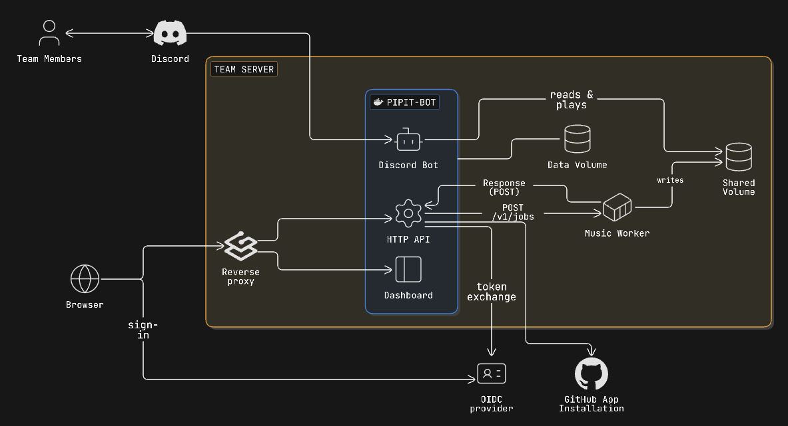
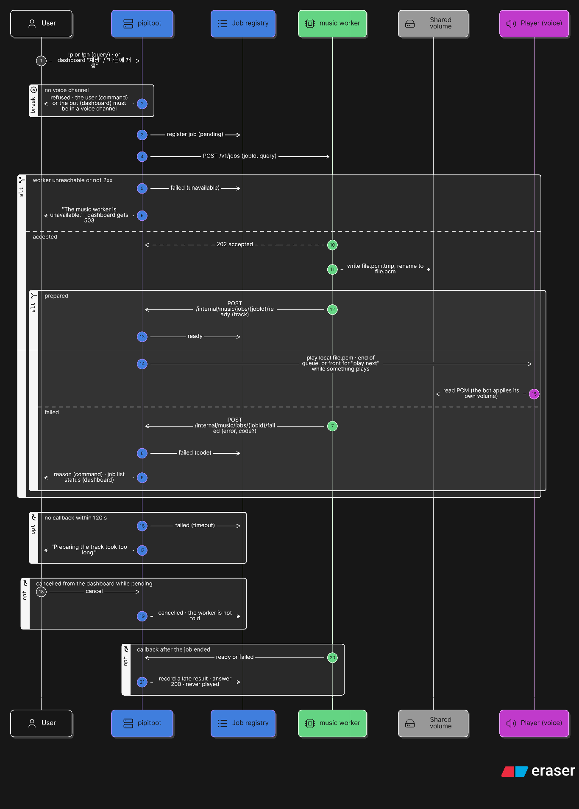
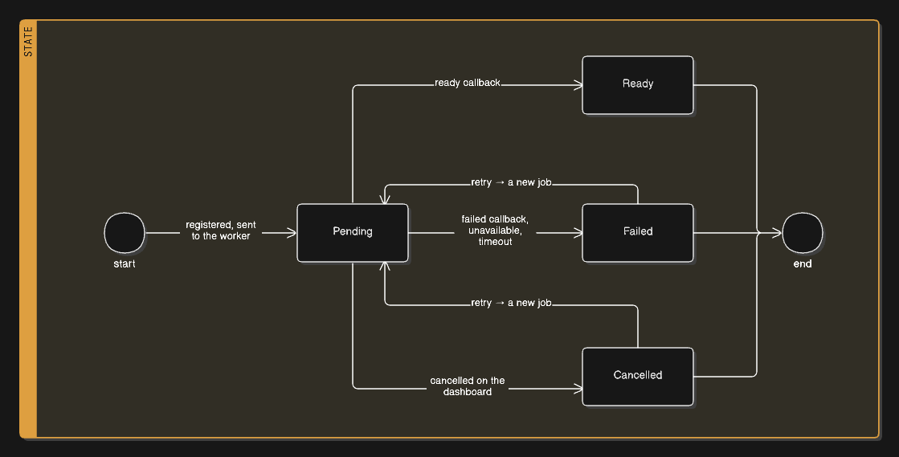
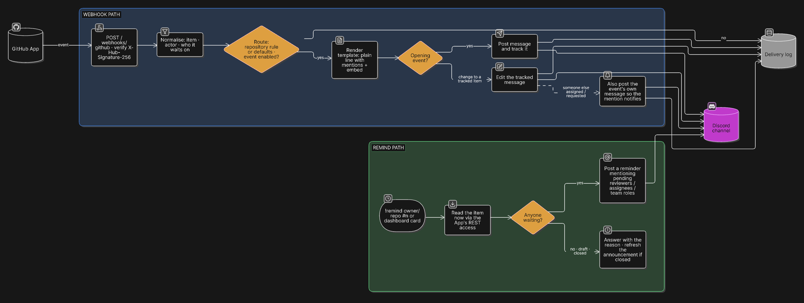

# 아키텍처

<p align="center"><a href="./ARCHITECTURE.md">English</a></p>

## 아이디어

작은 개발팀은 이미 디스코드에서 지냅니다. Pipit은 팀의 나머지 일상 업무를 그곳으로 가져옵니다 — 누군가를 기다리는 PR과
Issue, 역할과 온보딩, 초대, 통화방에서 함께 듣는 음악까지. 여기저기 흩어진 봇과 설정 파일 대신 웹 대시보드 하나에서
설정합니다.

설계를 이끄는 생각은 세 가지입니다.

- **팀마다 배포는 하나.** 봇, API, 대시보드가 한 프로세스, 한 이미지입니다. 음악 준비만 따로 돕니다.
  ([결정 002](./decisions/002_v0.5.0_one-process.md))
- **봇은 디스코드를 알고, 나머지 일은 계약 뒤에 둔다.** GitHub는 GitHub App으로, 음악은 오디오 파일을 준비하는
  **music worker**로 연결됩니다. 봇은 오디오를 가져오거나 디코딩하지 않으며, 그것이 어디서 오는지 아무것도 가정하지
  않습니다. ([001](./decisions/001_v0.5.0_music-worker.md), [007](./decisions/007_v0.6.0_github-app-and-webhook.md))
- **사람이 바꾸는 것은 모두 대시보드에서.** 설정은 코드가 아니라 데이터이고
  ([003](./decisions/003_v0.5.0_settings-in-json-files.md)), 대시보드는 명령으로 할 수 있는 일을 모두 할 수 있습니다
  ([014](./decisions/014_v0.7.0_music-controls-on-the-dashboard.md)).

## 시스템



| 구성 요소 | 실행 형태 | 통신 대상 |
| --- | --- | --- |
| **pipit-bot** — 디스코드 봇, HTTP API, 대시보드 | Node.js 프로세스 하나, 컨테이너 하나 | 디스코드 게이트웨이·REST, GitHub API, music worker, OIDC 공급자 |
| **music worker** | 별도 컨테이너, [계약](./music-backend.md)을 구현한 무엇이든 | 봇에게서 작업을 받아 공유 볼륨에 파일을 쓰고 봇에게 콜백 |
| **공유 볼륨** (`STREAM_ROOT`) | 양쪽에 마운트된 Docker 볼륨 | 준비된 PCM 파일 — worker가 쓰고 봇이 읽음 |
| **`data/`** | 봇의 볼륨 | 설정과 추적 상태(JSON 파일) |
| **OIDC 공급자** | 팀이 운영하는 것 | 대시보드 로그인, 쓰기 권한용 그룹 |
| **GitHub App** | 조직에 설치 | 웹훅 전송, 봇이 PR·Issue·멤버를 읽게 해 줌 |

리버스 프록시로 공개하는 경로는 대시보드(`/`), API(`/api/*`), GitHub 웹훅(`/webhooks/github`)입니다. music worker의
콜백인 `/internal/*`은 같은 포트를 쓰지만 내부 네트워크에만 두어야 합니다.

## pipit-bot 내부

```
src/
  index.ts            시작: 설정 파일 로드, HTTP 서버 시작, 클라이언트 로그인
  commands/           슬래시 명령(Sapphire) — music/, /remind, /help, …
  listeners/          게이트웨이 이벤트 — 멤버 입장·퇴장, 초대, 반응, 음악 채널 채팅, ready
  interaction-handlers/  음악 배너의 버튼과 재생 입력 창
  preconditions/      명령 가드(음악 채널 전용 등)
  api/                내장 HTTP API(Hono)
    app.ts            앱 구성: 인증, /api/*, 라우트 모듈, 대시보드 정적 파일
    routes/           auth, github-notify, github-webhook, music, music-jobs, reaction-roles
    auth/             OIDC 세션, 조회·쓰기 가드, 내부 토큰 가드
    jobs/             음악 작업 레지스트리
  lib/                명령과 API가 함께 쓰는 모든 것
    music/            재생 상태·동작, 음성 연결, 작업 제출, 로컬 파일 추출기, 볼륨
    github/           웹훅 정규화, 발송, 템플릿, 메시지 추적, App 클라이언트, 리마인더
    reaction-roles/   패널과 설정
    embed/            GitHub 템플릿과 리액션 롤 패널이 함께 쓰는 임베드 모델
dashboard/            Vue SPA — dashboard/dist로 빌드되어 / 에서 제공
```

각 부분을 묶는 규칙은 하나입니다. **명령과 API 라우트는 얇게, 같은 `lib/` 함수를 부른다.** `/skip`, 배너의 다음
버튼, 대시보드의 건너뛰기 버튼은 모두 `skipPlayback()`을 실행하고, `/remind`와 리마인더 카드는 같은 리마인더를 실행합니다. 동작은
`lib/`에 한 번만 있습니다.

프로세스 안에는:

- **디스코드 클라이언트** — 슬래시 명령, 버튼·입력 창 핸들러, 게이트웨이 리스너를 가진 Sapphire 클라이언트, 그리고 로컬 파일만 읽는 추출기
  하나를 쓰는 `discord-player`의 `Player`. 파일이 이미 출력 형식이라 플레이어의 오디오 처리 단계는 꺼 두고, 볼륨은 봇이
  스트리밍하면서 직접 적용합니다 ([015](./decisions/015_v0.7.0_bot-side-volume.md)).
- **HTTP API** — Node HTTP 서버 위의 Hono 앱. 클라이언트가 로그인하기 전에 시작합니다. 대시보드 라우트는 로그인한
  세션이 필요하고, 설정을 바꾸려면 관리자 그룹이어야 합니다. worker 콜백은 내부 토큰이 필요합니다.
- **메모리** — 음악 작업 레지스트리, 플레이어의 대기열과 기록, GitHub 목록의 짧은 캐시. 재시작하면 다시 만들어지거나
  사라집니다.
- **디스크** — `data/` 아래의 설정과 추적 중인 GitHub 메시지. 시작할 때 읽고, 바뀔 때 파일 전체를 씁니다.

## 음악 재생





1. 사용자가 곡을 요청합니다 — `/play`, 음악 채널에 친 한 줄, 배너의 재생 입력 창, 또는 대시보드의 재생 입력. 쿼리는 **불투명한 문자열**이라
   봇이 해석하지 않습니다.
2. 봇이 **작업**을 등록하고 music worker에 보냅니다(`POST /v1/jobs`).
3. worker가 오디오를 준비해 공유 볼륨에 `{file}.pcm`을 쓰고, 제목·길이·파일 이름과 함께 `ready`를 콜백합니다 — 또는
   오류와 (선택) 코드를 담아 `failed`를 콜백합니다.
4. 봇이 통화방에서 로컬 파일을 재생합니다. 대기열 끝에, "다음에 재생"이면 맨 앞에.

작업은 언제나 끝납니다 — 준비됨, 실패, 시간 초과, 취소 중 하나로. 대시보드는 최근 작업과 결과를 보여 줍니다
([016](./decisions/016_v0.7.1_music-job-lifecycle.md)). 대기열, 음성 연결, 볼륨은 봇의 것이고 worker는 보지 않습니다.

## GitHub 알림



1. GitHub App이 이벤트를 `/webhooks/github`로 보내고, 서명을 검증합니다.
2. 이벤트를 하나의 형태(항목, 행위자, 기다리는 사람들)로 **정규화**하고 **라우팅**합니다: 저장소의 채널과 켜진 이벤트,
   또는 물려받는 기본값.
3. 이벤트의 **템플릿**이 임베드와 평문 줄을 만듭니다. 임베드 안의 멘션은 아무도 알림을 받지 않으므로 멘션은 평문 줄에
   둡니다 ([008](./decisions/008_v0.6.4_embed-notifications.md)).
4. 여는 이벤트는 메시지를 게시하고 **추적**합니다. 같은 항목의 이후 변화는 새로 게시하지 않고 그 메시지를 수정합니다
   ([009](./decisions/009_v0.6.4_one-message-per-item.md)).
5. 모든 수신과 결과는 대시보드가 보여 주는 짧은 기록에 남습니다.

리마인더는 반대 방향입니다. `/remind`는 그 순간 GitHub에서 항목을 읽어 아직 기다리고 있는 사람을 부릅니다
([012](./decisions/012_v0.6.6_reminders-read-github-on-demand.md)).

## 대시보드

Vue 3 단일 페이지 앱(Vite, reka-ui 기반 shadcn-vue, Tailwind)으로, `dashboard/dist`에 빌드되어 봇이 제공합니다. 봇의
OIDC 클라이언트로 로그인하고([004](./decisions/004_v0.5.0_dashboard-sign-in-with-oidc.md)) `/api/*`하고만 통신합니다.
실시간 화면은 폴링하며 WebSocket은 없습니다. 모든 페이지가 하나의 디자인 시스템과 같은 선택 창 규칙을 씁니다
([011](./decisions/011_v0.6.4_dashboard-design-system.md), [013](./decisions/013_v0.6.8_lists-are-not-authoritative.md)).

## 배포

- 릴리즈마다 이미지 하나 — 릴리즈 워크플로가 빌드해 컨테이너 레지스트리에 올립니다
  ([005](./decisions/005_v0.5.0_releases-by-workflow.md)).
- compose 파일이 봇과 music worker를 공유 볼륨으로 이어 실행하고, `data/`는 봇의 볼륨입니다.
- 환경 변수에는 배포 사실과 비밀만 둡니다(디스코드 토큰, OIDC, GitHub App, `INTERNAL_TOKEN`, `MUSIC_WORKER_URL`,
  `STREAM_ROOT`). 나머지는 모두 대시보드에서 설정합니다.

## 앞으로

방향은 [로드맵](./ROADMAP.ko.md)에 있습니다. 이 그림을 바꿀 변화는 두 가지입니다: 데이터베이스(v0.8)가 늘어나는 데이터의
JSON 파일을 대체하고 — 추적 중인 GitHub 메시지부터 — 감사 로그가 대시보드·음악·리마인더 조작을 기록합니다.
